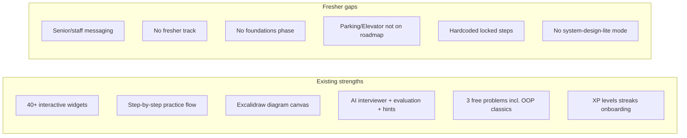
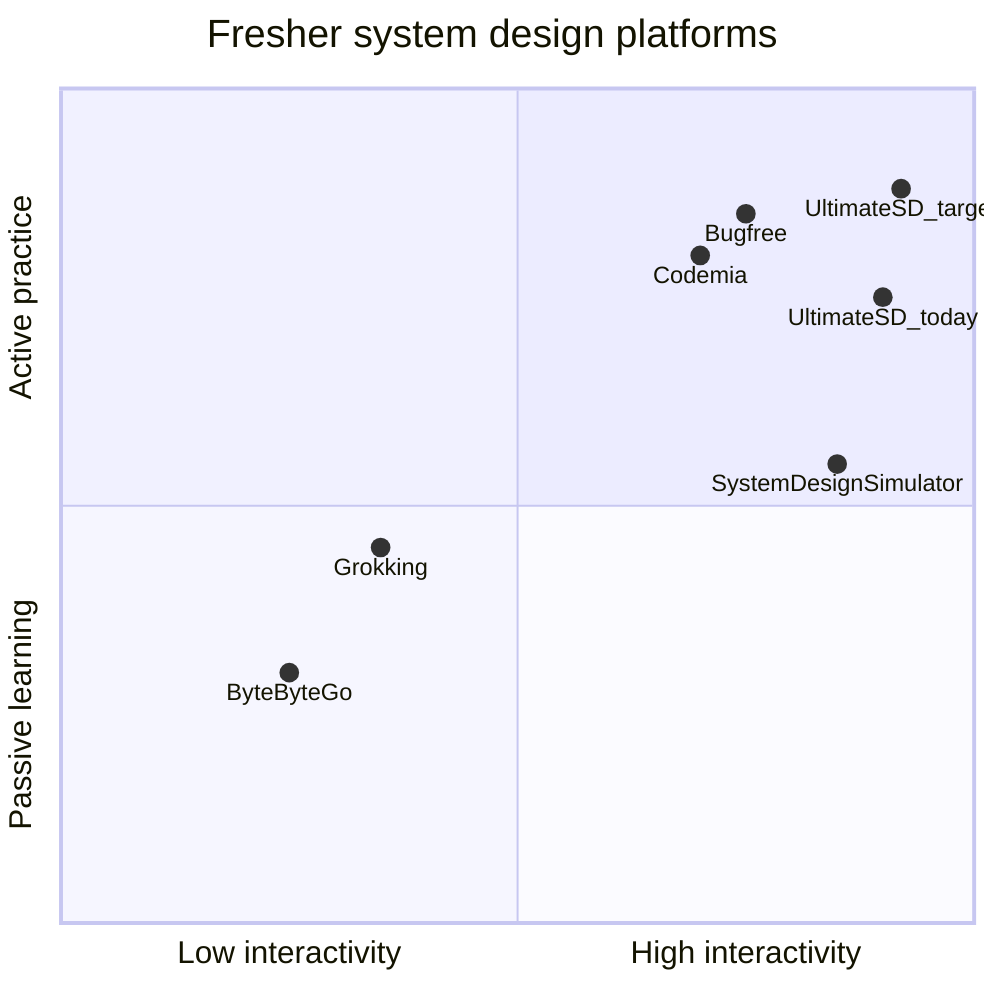

# Fresher-Focused Roadmap Review & Competitive Adoption Plan

> **Status:** Saved for later — not yet implemented.

**Goal:** Reposition Ultimate SD's roadmap and marketing for freshers with zero industry exposure—maximizing engagement and interview readiness.

**Architecture:** New `fresher` roadmap track, messaging refresh on landing/roadmap pages, progress-based unlocks, optional interview-lite mode. Builds on existing widgets, practice flow, and free-tier problems.

**App root:** `ultimate-sd/`

---

## Implementation todos

- [ ] Finalize fresher track curriculum (Phase 0 foundations + canonical 5 problems) in `RoadmapData.tsx`
- [ ] Update Hero, RoadmapPreview, and `/roadmap` page copy to lead with fresher/campus positioning; default `track=fresher`
- [ ] Add Parking Lot and Elevator to roadmap; align free tier slugs with fresher path steps
- [ ] Wire roadmap step status to user progress instead of hardcoded locked/unlocked
- [ ] Add 45-min lite interview mode with shortened phases and gentler AI prompts for fresher problems
- [ ] Fix onboarding toast and optionally route new users with Easy difficulty to fresher track

---

## Executive summary

Ultimate SD already has **strong differentiators** for freshers (interactive widgets, guided step-by-step practice, built-in diagrams, AI feedback, free classic problems)—but the **roadmap and marketing speak to senior/staff engineers**, not campus hires. Freshers landing on the site see "scale to billions" and four role tracks (Senior SE, MLOps, Agentic AI) before they see a safe on-ramp.

The opportunity: position Ultimate SD as **"Grokking's interview framework + System Design Simulator's interactivity + Codemia's practice loop"**—at India-friendly pricing—with a dedicated **Fresher / Campus** path that starts from zero.

---

## Part 1: Similar products (beginner / fresher system design)

| Product | Core approach | Why freshers use it | Engagement hook |
|---------|---------------|---------------------|-----------------|
| **[Grokking System Design](https://www.designgurus.io/)** (DesignGurus / Educative) | Case-study framework; introduces concepts inside problems | Gold standard for first-timers; no prior scale experience assumed | Repeatable 7-step template; canonical interview problems |
| **[ByteByteGo](https://bytebytego.com/)** | Visual-first explanations, diagrams, newsletters | Builds vocabulary without intimidation | Beautiful diagrams; "see it before you design it" |
| **[System Design Simulator](https://systemdesignsimulator.org/)** | Free browser widgets for HLD + internals + DSA | Closest to Ultimate SD's simulation angle | 8-week structured plan; poke/break/fix widgets |
| **[Codemia.io](https://codemia.io/)** | LeetCode-style submit → AI feedback → iterate | Active practice, not passive reading | Feedback loops, editorial solutions, progress feel |
| **[Bugfree.ai](https://bugfree.ai/)** | Timed practice + AI mocks + leaderboards | Interview pressure simulation | Gamification, scores, streak-like progression |
| **[NeetCode](https://neetcode.io/)** | Simpler system design explainers | Recommended explicitly for beginners/freshers | Low barrier, familiar brand from DSA prep |
| **[InterviewChamp.ai](https://interviewchamp.ai/)** | New-grad **"system design lite"** bar | Defines the *actual* fresher interview (45 min, 5–7 boxes, one tradeoff) | Canonical 5 problems, 2-week plan, vocabulary-first |
| **[Exponent](https://www.tryexponent.com/)** | Peer/expert mock interviews | Social accountability | Live dialogue practice |
| **Community roadmaps** ([DEV fresher roadmap 2026](https://dev.to/avinash201199/system-design-roadmap-for-freshers-2026-from-zero-to-placement-ready-4gl4), InterviewNoodle) | Free frameworks + weekly schedules | India placement context; OOP + basic HLD | Timed mocks, diagram discipline, company-specific tips |

**Common patterns across winners:**
1. **Foundations before Netflix** — HLD vs LLD, NFRs, CAP, latency/throughput, interview structure
2. **Canonical fresher problems** — URL shortener, parking lot, elevator, rate limiter, pastebin, basic chat/feed (not billion-user systems on day one)
3. **Explicit interview framework** — 4-step lite (new grad) or 7-step (full); always: clarify → estimate → API/HLD → tradeoffs
4. **Diagrams are mandatory** — canvas/whiteboard is half the round
5. **Timed 45-minute practice** — reduces anxiety through repetition
6. **Progression dopamine** — unlock next problem, streaks, scores (Bugfree/Codemia model)
7. **India nuance** — product companies (HLD lite) vs service companies (LLD/OOP); placement-season pacing

---

## Part 2: Ultimate SD today — gap analysis

### What you have (assets freshers need)



| Area | Current state | Fresher impact |
|------|---------------|----------------|
| Hero (`Hero.tsx`) | "Scale to billions"; "senior & staff interviews" | Intimidating; wrong ICP signal |
| Roadmap preview (`RoadmapPreview.tsx`) | "Junior to Staff" but 4 tracks are **role** tracks | Freshers pick Senior SE / Agentic AI and bounce |
| Roadmap data (`RoadmapData.tsx`) | SE track jumps Beginner → Intermediate in phase 1; only **2** Beginner labels | No gentle ramp |
| Free tier (`plans.ts`) | TinyURL + **Parking Lot** + **Elevator** | Perfect fresher problems—but **not on the SE roadmap** |
| Onboarding (`OnboardingModal.tsx`) | "Your specialized roadmap is ready" | Trust break: roadmap is static |
| Progress | Locked/unlocked hardcoded; DB progress sync explicitly out of scope | No unlock loop = lower retention |
| Practice phases | Requirements → HLD → LLD → Trade-offs → Scalability | Heavier than new-grad "lite" bar |

### Competitive positioning map



Ultimate SD is already **high-interactivity** (your moat). The missing piece is **fresher-specific structure and messaging**, not more widgets.

---

## Part 3: Adopt competitor approaches in Ultimate SD

### A. Grokking / InterviewChamp — **Framework-first fresher track**

**Adopt:** A dedicated **"Fresher & Campus"** track (new `TrackInfo` id: `fresher`) or rebrand the default SE track with **Phase 0: Foundations**.

**Phase 0 content (no practice problem yet — concept cards or micro-lessons):**
- What is system design? HLD vs LLD
- Functional vs non-functional requirements
- CAP, consistency vs availability (with India examples: bank vs social feed)
- The 4-step lite framework: Clarify → Rough scale → 5-box diagram + API → One tradeoff
- How to use the diagram canvas in an interview

**Phase 1 — Canonical five** (align with InterviewChamp + India fresher roadmaps):

| Step | Problem | Why | Ultimate SD status |
|------|---------|-----|-------------------|
| 1 | TinyURL | Hashing, redirects, first HLD | On roadmap, free, has widgets |
| 2 | Parking Lot | OOP/LLD for service companies | **Free but missing from roadmap** |
| 3 | Elevator | State machine, scheduling | **Free but missing from roadmap** |
| 4 | Rate Limiter | Scalability intro | On roadmap, has `rate-limiter-demo` widget |
| 5 | Pastebin or basic Chat | Simple storage/messaging | Check catalog; add if missing |

**Files to change:** `RoadmapData.tsx`, `RoadmapTypes.ts` (add `Foundations` step type or link to `/learn/...` pages).

### B. System Design Simulator — **8-week schedule + default track**

**Adopt:** Surface a **"8-week fresher plan"** banner on `/roadmap` and homepage preview:
- ~5–8 hrs/week
- Week 1–2: Foundations + TinyURL + Parking Lot
- Week 3–4: Elevator + Rate Limiter
- Week 5–6: Notification or REST API
- Week 7–8: Timed mock on one problem

**Implementation:** Add `estimatedWeek` and `hoursPerStep` metadata to roadmap steps; show progress bar on roadmap page.

### C. Codemia / Bugfree — **Practice loop + unlock progression**

**Adopt:**
- **Unlock next step on completion** (wire roadmap to existing progress in `progress.ts`) — highest ROI engagement fix
- **"Try again" feedback loop** — already in `StepByStepChat`; surface score on roadmap node ("72% — retry to unlock")
- **Fresher leaderboard or "completed this week"** — light social proof (optional phase 2)

**Note:** `docs/superpowers/specs/2026-06-27-db-progress-restructure-design.md` marked roadmap progress out of scope — **revisit for fresher retention**.

### D. ByteByteGo — **Concept primers before each problem**

**Adopt:** Each fresher roadmap step gets a **"Read first (5 min)"** collapsible: 3–5 bullet concepts + link to relevant widget demo (e.g., before Rate Limiter → open `rate-limiter-demo` in sidebar).

Low-effort version: extend step `description` in `RoadmapData.tsx` with `prerequisiteConcepts: string[]`.

### E. NeetCode / community roadmaps — **Tone and India context**

**Adopt in copy:**
- "No industry experience required"
- "Start with problems companies actually ask freshers—not billion-user Netflix"
- Optional callouts: Amazon (LLD-heavy), Google/Meta (HLD lite), service cos (OOP)
- CTA: **"Start Fresher Path"** as primary hero button (not `#features`)

**Files:** `Hero.tsx`, `RoadmapPreview.tsx`, `roadmap/page.tsx`, `layout.tsx` SEO metadata.

### F. Exponent — **Mock interview mode (phase 2)**

**Adopt:** **"Interview Lite" mode** on practice page for fresher-flagged problems:
- 45-minute timer (you have `TimerWidget.tsx`)
- Fewer phases: Clarify → HLD diagram → Tradeoffs only
- AI interviewer uses gentler prompts (separate prompt profile in `langgraph.ts`)

---

## Part 4: Recommended roadmap restructure

### New track: `fresher` (default for logged-out / first visit)

```
Phase 0: Foundations (concepts only)
Phase 1: OOP & LLD Classics     → Parking Lot, Elevator
Phase 2: First HLD Problems     → TinyURL, REST API
Phase 3: Scale Basics            → Rate Limiter, Notification System
Phase 4: Interview Ready         → Timed mock + Pastebin/Chat
```

Keep existing **SE / Senior SE / MLOps / Agentic AI** tracks for upsell path: *"Finished fresher path? Continue to Software Engineer track."*

### Homepage roadmap preview change

Replace 4 equal cards with **one hero fresher card** + "Explore all career paths":
- Primary: **Fresher & Campus** — "Zero to placement-ready in 8 weeks"
- Secondary link: role-based tracks for experienced engineers

### Messaging matrix

| Location | Today | Proposed fresher line |
|----------|-------|----------------------|
| Hero H1 | Master Systems That Scale to Billions | **Learn System Design From Zero** |
| Hero sub | Flash sales, secrets, databases | **Practice the problems freshers actually get— with AI guidance and interactive simulations** |
| Hero footer | senior & staff | **For students, freshers, and engineers with 0–2 years experience** |
| Roadmap badge | ROLE BASED CURRICULUM | **CAMPUS & FRESHER PATH** (on fresher track) |
| Roadmap H1 | Your Path to Mastery | **Your First 8 Weeks of System Design** |

---

## Part 5: Phased implementation (recommended order)

### Phase 1 — Content & positioning (1–2 days, no backend)
- Add `fresher` track to `RoadmapData.tsx` with phases above
- Add Parking Lot + Elevator to roadmap steps
- Update Hero, RoadmapPreview, `/roadmap` header copy; default `?track=fresher`
- Fix onboarding toast: "Preferences saved" (remove false "roadmap is ready" until personalized)
- Add fresher-focused SEO in `layout.tsx`

### Phase 2 — Engagement mechanics (3–5 days)
- Sync roadmap `status` from user progress (completed problem → unlock next)
- Show completion % per phase on roadmap nodes
- Add 8-week timeline metadata + visual schedule on roadmap page
- Expand free tier to 5 problems matching canonical five (product decision — `plans.ts`)

### Phase 3 — Interview lite experience (1 week)
- `interviewMode: 'lite' | 'full'` per problem or track
- Shorter phase list for lite mode in `problem-steps.ts` / `step-journey.ts`
- Fresher-tuned AI interviewer system prompt
- Optional: `/roadmap/fresher/guide` static page with framework cheat sheet

### Phase 4 — Differentiation depth (ongoing)
- Foundation micro-lessons (could reuse widget embeds as "concept labs")
- Company-specific mini-paths from onboarding preferences
- Shareable "roadmap progress" card for LinkedIn (placement season marketing)

---

## Part 6: Success metrics for fresher engagement

| Metric | Why |
|--------|-----|
| % new users starting `track=fresher` | Positioning working |
| Completion rate Phase 0 → first free problem | On-ramp not intimidating |
| D7 return rate after TinyURL/Parking Lot | Stickiness vs one-and-done |
| Avg time-on-practice for fresher problems | Depth of engagement |
| Free → paid conversion after problem 3 | Monetization without blocking learning |
| NPS / feedback from users selecting "Easy" in onboarding | Message-market fit |

---

## Key files reference

| Purpose | Path |
|---------|------|
| Roadmap content | `ultimate-sd/src/components/roadmap/RoadmapData.tsx` |
| Roadmap page | `ultimate-sd/src/app/roadmap/page.tsx` |
| Landing preview | `ultimate-sd/src/components/landing/RoadmapPreview.tsx` |
| Hero copy | `ultimate-sd/src/components/landing/Hero.tsx` |
| Free problems | `ultimate-sd/src/lib/plans.ts` |
| Practice flow | `ultimate-sd/src/components/StepByStepChat.tsx` |
| Progress actions | `ultimate-sd/src/app/actions/progress.ts` |

---

## Bottom line

**Do not compete with ByteByteGo on passive depth or Bugfree on problem count alone.** Compete on: **"The only fresher system design path where you learn by breaking simulations, drawing architecture, and getting AI feedback—starting from Parking Lot, not Netflix."**

Your roadmap section should lead with that story, wire free problems into a visible path, and unlock the next step when freshers finish the last—turning Ultimate SD from a senior interview tool into the **default starting point** for engineers with no industry exposure.
