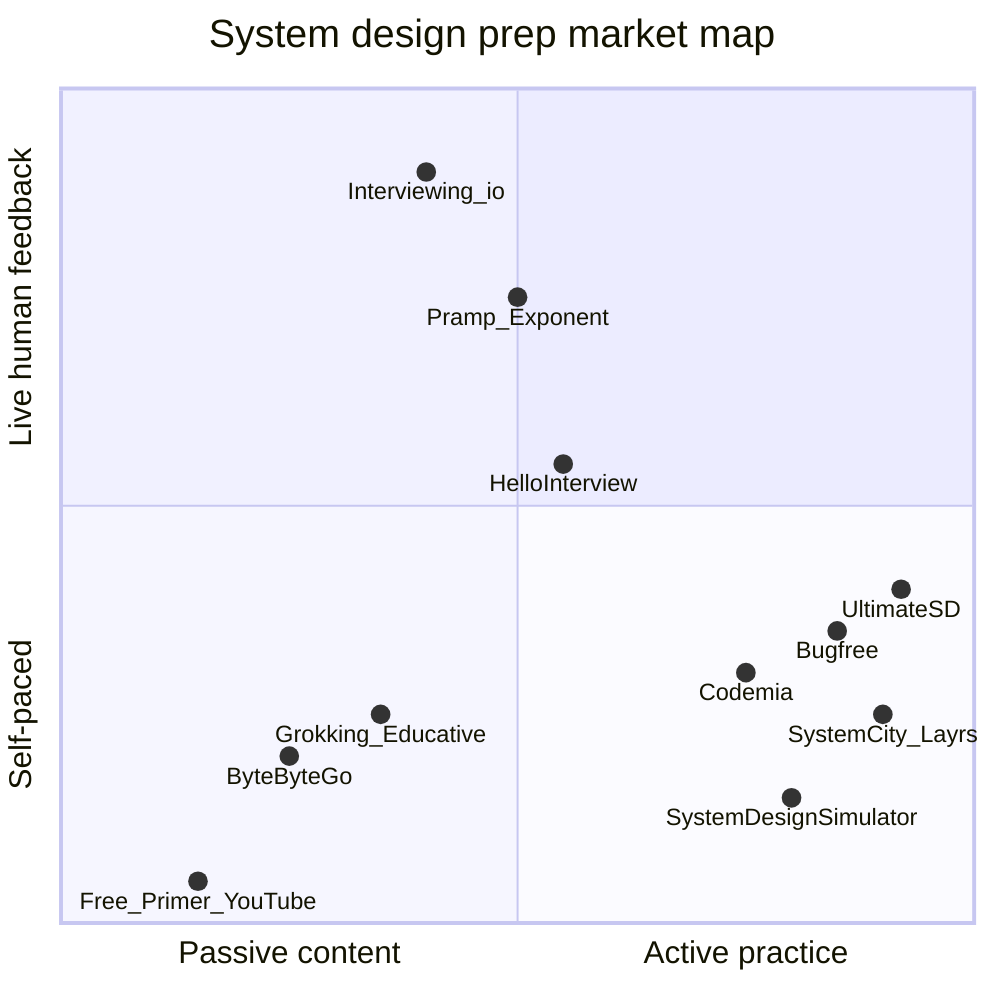
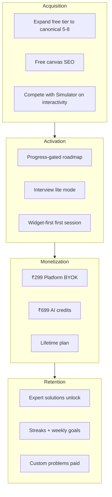

# Ultimate SD — Full Competitive Analysis (2026)

> **Scope:** Overall market positioning across all experience levels — not limited to freshers.  
> **Status:** Research artifact; complements [fresher roadmap plan](../plans/2026-06-30-fresher-roadmap-review.md).

---

## 1. Market landscape

The system design interview prep market splits into **five categories**. Most candidates combine 2–3 categories; no single product wins every segment.

| Category | Role in prep stack | Typical price |
|----------|-------------------|---------------|
| **Structured courses** | Teach frameworks & canonical problems | $40–$200/course or $80–$200/yr |
| **Interactive practice** | Build designs, get AI/peer feedback | $0–$70/yr |
| **Mock interviews (human)** | Calibrate against hiring bar | $150–$350/session |
| **Mock interviews (AI)** | Daily reps, low cost | $0–$50/mo |
| **Free foundations** | Vocabulary, diagrams, reference | $0 |

**Ultimate SD sits primarily in interactive practice**, with course-like structure (step-by-step) and AI mock elements — closest to Hello Interview Guided Practice, SystemCity, Layrs, Codemia, and System Design Simulator, with a unique simulation/widget layer.

---

## 2. Competitor inventory (20+ products)

### A. Structured courses & content libraries

| Product | Format | Problems / depth | Mocks | AI | Price (approx.) | Best for |
|---------|--------|------------------|-------|-----|-----------------|----------|
| **[Grokking System Design](https://www.designgurus.io/)** (DesignGurus) | Text + case studies + framework | 16+ core + Vol II advanced | 1:1 coaching add-on | Sketch + feedback (2026 update) | $79–$199/course | All levels; gold-standard framework |
| **[Grokking Fundamentals](https://www.designgurus.io/)** | Intro course | Concepts before problems | No | Limited | Bundled | Beginners |
| **[Educative Grokking](https://www.educative.io/)** | Interactive text in browser | Same Grokking lineage + broader CS | Premium AI mocks | Yes (premium) | ~$15/mo (subscription) | Self-paced coders wanting DSA + SD bundle |
| **[ByteByteGo](https://bytebytego.com/)** | Visual diagrams, video, newsletter | 30+ designs; ML/GenAI tracks | No | AI mocks (newer) | ~$80–$200/yr | Visual learners; fundamentals depth |
| **[Alex Xu books](https://www.amazon.com/)** | Book | ~15 classic designs | No | No | ~$40/vol | Everyone; baseline reference |
| **[Udemy SD Masterclass](https://www.udemy.com/)** | Video | Varies | No | No | $15–$30 | Budget video learners |
| **[Interview Kickstart](https://interviewkickstart.com/)** | Bootcamp | Cohort curriculum | Live sessions | No | $1000s | Intensive paid bootcamps |
| **[Exponent courses](https://www.tryexponent.com/)** | Video + articles | Broad (PM, EM, eng) | Peer + paid expert | Limited | ~$79/mo | PM/EM + structured learning path |

### B. Interactive practice (direct competitors)

| Product | Format | Problems | Canvas | AI feedback | Unique hook | Price (approx.) |
|---------|--------|----------|--------|-------------|-------------|-----------------|
| **[Hello Interview](https://www.hellointerview.com/)** | Video + Guided Practice | SD + LLD + behavioral library | Whiteboard-first; AI reads drawing | Per-step FAANG-tuned | Mock marketplace with ex-Meta/Amazon engineers | Premium ~$59/mo; mocks $200–$300/session |
| **[SystemCity](https://systemcity.io/)** | Build architectures | 120+ | Drag-drop interactive canvas | Unlimited AI eval | High-volume practice vs watching videos | ~$59/mo |
| **[Layrs](https://layrs.me/)** | Design Studio + AI mocks | 120+ curated | HLD/LLD drag-drop | Seniority-aware | Full interview room simulation (SD + DSA + LLD) | Paid tiers |
| **[Codemia.io](https://codemia.io/)** | LeetCode-style workspace | 120+ SD, OOD | Text/diagram workspace | Iterative post-submit | 75+ editorial solutions | ~$59–$69/yr |
| **[Bugfree.ai](https://bugfree.ai/)** | Timed LeetCode-style | 150+ SD (3200+ all types) | Yes | Scores + AI mocks | Gamification, leaderboards, largest bank | Varies; lifetime deals |
| **[TechPrep](https://www.techprep.xyz/)** | Full job prep | 34 core SD + roadmap | AI whiteboard | Rubric feedback | Resume + ATS + 1:1 plan in 48h | Subscription tiers |
| **[System Design Simulator](https://systemdesignsimulator.org/)** | Animated widgets | 27 HLD + 32 internals + 47 DSA | Simulation, not draw | N/A (authored prose) | Free; Java code; 8-week plan | **Free** |
| **[Sysiq](https://sysdesignsaas.vercel.app/)** (early) | Canvas + guided cases | Growing | Purpose-built SD canvas | Structural anti-pattern checks | Pre-launch; browser-native | TBD |
| **[Ultimate SD](https://ultimatesd.com/)** (us) | Step-by-step + widgets | **86** catalog | Excalidraw | Evaluate + Help + BYOK | **47 embedded simulations**; Agentic AI track | Free (3) / ₹299 / ₹699 mo |

### C. Mock interview platforms (human-led)

| Product | Format | SD quality | Price | Best for |
|---------|--------|------------|-------|----------|
| **[Interviewing.io](https://interviewing.io/)** | Anonymous voice with FAANG engineers | Excellent (L5/L6+) | $225–$350+/session | Final polish, honest calibration |
| **[Pramp](https://www.pramp.com/)** (Exponent) | Peer-to-peer video | Weak for SD depth | Free (5 credits/mo) | Volume, nerves, coding + light SD |
| **[Exponent mocks](https://www.tryexponent.com/)** | Peer + expert marketplace | Medium–high | $25–$50/session or sub | Bundled with courses |
| **[IGotAnOffer](https://igotanoffer.com/)** | Expert coaching marketplace | High | $100s/session | Company-specific coaching |
| **[Hello Interview marketplace](https://www.hellointerview.com/)** | Video with vetted coaches | High | $200–$300/session | SD communication + pacing |
| **[DesignGurus coaching](https://www.designgurus.io/)** | Ex-FAANG hiring managers | High | Premium add-on | Rubric-calibrated feedback |

### D. AI-only mock specialists

| Product | Focus | Notes |
|---------|-------|-------|
| **Mockingly.ai** | Adversarial follow-ups | Builds composure under probing |
| **MockMe.ai** | Voice + whiteboard | Most realistic voice simulation |
| **HackerRank AI Mocks** | Platform-native | Practice on actual interview UI |
| **Thita.ai** | General AI mocks | Emerging player |

### E. Free / community resources

| Resource | Value | Gap vs Ultimate SD |
|----------|-------|-------------------|
| **[System Design Primer](https://github.com/donnemartin/system-design-primer)** (GitHub) | Comprehensive free reference | No practice loop, no feedback |
| **ByteByteGo YouTube / Gaurav Sen** | Visual walkthroughs | Passive |
| **InterviewNoodle / DEV roadmaps** | Frameworks + weekly plans | No product integration |
| **NeetCode SD** | Beginner-friendly explainers | Thin practice tooling |

---

## 3. Ultimate SD — current capability snapshot

| Dimension | Shipped today | Competitive tier |
|-----------|---------------|------------------|
| Problem bank | 86 (3 Easy / 44 Med / 40 Hard) | Mid (Codemia/Bugfree larger) |
| Interactive widgets | **47** embedded simulations | **Leader** (only System Design Simulator comparable) |
| Practice structure | 5 phases × sub-steps, per-problem curricula | **Leader** (deeper than most) |
| Diagram tooling | Excalidraw + PNG export + free `/draw` | Strong |
| AI stack | Evaluate + Socratic Help + BYOK (7 providers) | Strong flexibility |
| AI mock dialogue | Legacy chat API; not main UX | **Behind** Hello/Layrs/Bugfree |
| Human mocks | None | **Missing** |
| Video content | None | **Missing** |
| Editorial solutions | Built but **disabled** (`solutionViewer: false`) | Behind Codemia/Grokking |
| Roadmaps | 4 role tracks; static lock state | Mid structure, weak progression |
| Gamification | XP, levels, streaks | Mid (Bugfree stronger) |
| Free tier | 3 problems, 20 AI credits/mo | **Weak** vs Simulator (free) / Hello (partial free) |
| Pricing | ₹299 Platform / ₹699 AI monthly | Competitive in India; no lifetime |
| Mobile | Responsive web only | Parity with most; no native app |
| Custom problems | Paid only | Differentiator but gated |
| Agentic AI / MLOps tracks | Unique roadmap slices | **Differentiator** |
| Admin / launch growth | Razorpay, launch offer slots | Ops-ready |

---

## 4. Feature-by-feature scorecard

Legend: ✅ Strong · ⚠️ Partial · ❌ Missing · 🏆 Best-in-class

| Feature | Ultimate SD | Grokking | ByteByteGo | Hello Interview | Codemia | Bugfree | Sys. Simulator | SystemCity/Layrs |
|---------|-------------|----------|------------|-----------------|---------|---------|----------------|------------------|
| Interview framework teaching | ⚠️ In steps | 🏆 | ✅ | ✅ | ⚠️ | ⚠️ | ✅ | ⚠️ |
| Step-by-step guided practice | 🏆 | ⚠️ | ❌ | 🏆 | ✅ | ✅ | ⚠️ | ✅ |
| Interactive simulations | 🏆 | ❌ | ⚠️ Video | ❌ | ❌ | ❌ | 🏆 | ⚠️ |
| Draw-your-own diagram | ✅ Excalidraw | ⚠️ | ❌ | 🏆 | ✅ | ✅ | ❌ | 🏆 drag-drop |
| AI per-step evaluation | 🏆 | ⚠️ New | ⚠️ | 🏆 | ✅ | ✅ | ❌ | ✅ |
| AI adversarial interviewer | ⚠️ Legacy | ❌ | ❌ | ✅ | ⚠️ | ✅ | ❌ | 🏆 Layrs |
| Expert written solutions | ❌ Disabled | 🏆 | 🏆 | ✅ | 🏆 75+ | ⚠️ AI | ✅ Prose | ⚠️ |
| Human mock marketplace | ❌ | ✅ Paid | ❌ | 🏆 | ⚠️ | ❌ | ❌ | ❌ |
| OOD / LLD track | ⚠️ Problems exist | ✅ Course | ⚠️ | 🏆 | 🏆 | ✅ | ❌ | 🏆 Layrs |
| Problem count | ⚠️ 86 | ⚠️ ~16–30/course | ⚠️ 30+ | ✅ Large library | 🏆 120+ | 🏆 150+ SD | ⚠️ 27 HLD | 🏆 120+ |
| Free tier generosity | ❌ 3 problems | ❌ | ⚠️ Some free | ✅ Partial | ⚠️ Some free | ⚠️ | 🏆 Free | ⚠️ Browse free |
| Gamification | ⚠️ XP/streak | ❌ | ❌ | ⚠️ | ⚠️ | 🏆 | ❌ | ⚠️ |
| Staff+ / advanced depth | ✅ Hard problems | 🏆 Vol II/Advanced | 🏆 | ✅ | ⚠️ | ⚠️ | 🏆 Internals | ⚠️ |
| ML / Agentic design | 🏆 Tracks | ⚠️ Add-on courses | 🏆 | ⚠️ | ❌ | ❌ | ❌ | ❌ |
| India pricing (INR) | 🏆 | ❌ USD | ❌ USD | ❌ USD | ❌ USD | ❌ USD | Free | ❌ USD |
| BYOK / cost control | 🏆 7 providers | ❌ | ❌ | ❌ | ❌ | ❌ | N/A | ⚠️ |

---

## 5. What competitors do well (good to have)

### Must-have table stakes (candidates expect these)

1. **Clear interview framework** — Clarify → estimate → API → HLD → deep dive → tradeoffs (Grokking, Hello, InterviewNoodle). Without this, users feel lost.
2. **Canonical problem coverage** — URL shortener, rate limiter, chat, feed, paste storage, notification, search, video, payments (all major platforms).
3. **Diagram / whiteboard practice** — Drawing is ~50% of the interview (Hello, SystemCity, Layrs, Codemia).
4. **Feedback on *your* design** — Not just reading solutions (Codemia, Hello, Bugfree, SystemCity).
5. **Progression signal** — What to do next, what's completed (Bugfree, Grokking paths, Simulator 8-week plan).

### High-impact differentiators (win conversions)

6. **Expert solutions to compare against** — Codemia (75+), Grokking, ByteByteGo. Users want a "model answer" after struggling.
7. **Timed interview mode** — 45–60 min pressure (Bugfree, Hello, Layrs, Sysiq).
8. **Generous free tier** — Top-of-funnel (System Design Simulator fully free; Hello partial; Pramp free mocks).
9. **Human mock path** — Even a partner marketplace link (Hello, Interviewing.io). Senior candidates expect this.
10. **Company-specific prep** — "Most asked at Meta/Amazon" (Hello ranked lists, Exponent, DesignGurus).

### Segment-specific strengths

| Segment | What winners offer |
|---------|-------------------|
| **Freshers** | Lite bar, OOP classics, 2–8 week plan, low intimidation (NeetCode, Grokking Fundamentals, InterviewChamp) |
| **Mid-level (L3–L4)** | Framework + 15–20 classic HLD problems + AI practice (Grokking + Codemia combo) |
| **Senior (L5)** | Adversarial follow-ups, deep tradeoffs, flash sale/payment/chat at scale (ByteByteGo, Hello, Interviewing.io) |
| **Staff+** | Consensus, geo-replication, evolution, ML systems (Grokking Advanced, ByteByteGo ML/GenAI) |
| **India campus** | INR pricing, OOP/LLD for service cos, placement timing (community roadmaps; **gap in paid products**) |

---

## 6. Where Ultimate SD already wins

1. **Simulation depth** — 47 in-flow widgets (rate limiter demo, flash sale, consistent hashing, RAG architect, etc.) beats every paid competitor except System Design Simulator's free catalog.
2. **Problem-specific curricula** — `problem-steps.ts` tailors prompts and widgets per problem; most competitors use one generic rubric.
3. **Integrated practice cockpit** — Steps + diagram + schema builder + timer + help + PDF in one session.
4. **Agentic AI & MLOps roadmaps** — Ahead of Grokking/Codemia for 2026 interview trends.
5. **BYOK + cheap Platform tier** — ₹299 for full library without forcing AI subscription; appeals to cost-conscious India market and power users.
6. **Free Draw canvas** — Low-friction acquisition (`/draw` without login).
7. **Custom problems** — Full AI pipeline on user-authored prompts (rare; Hello/Layrs have BYOP variants).

**Defensible positioning statement:**

> *"The most hands-on system design practice platform — learn by breaking simulations, not watching videos."*

---

## 7. Gaps and improvements (prioritized)

### P0 — Fix positioning & trust (no heavy engineering)

| Gap | Evidence | Recommendation |
|-----|----------|----------------|
| Senior-only marketing | Hero: "senior & staff", "billions" | Dual ICP: fresher path + senior path; segment landing copy |
| Free tier too stingy | 3 problems vs 8 in `REVENUE_LAUNCH_PLAN.md` | Expand to 5–8 canonical problems; matches Simulator/Hello free depth |
| Solutions disabled | `features.ts`: `solutionViewer: false` | Enable for paid tier or post-completion unlock — table stakes vs Codemia |
| False onboarding promise | "Your specialized roadmap is ready" | Honest copy until personalization ships |
| Static roadmap locks | No progress sync | Wire to `progress.ts` — highest engagement ROI |

### P1 — Close competitive gaps (medium effort)

| Gap | vs competitor | Recommendation |
|-----|---------------|----------------|
| No timed "interview mode" | Bugfree, Hello, Layrs | 45/60-min mode; lite vs full phase sets |
| No adversarial AI interviewer in main UX | Hello, Layrs, Mockingly | Promote `/api/ai/chat` into practice as optional "probe mode" |
| No expert/editorial solutions | Codemia, Grokking | Ship `SolutionViewer`; add "compare to expert" after pass |
| Weak mock interview story | Hello, Interviewing.io | Partner marketplace later; short-term: "export PDF + peer practice guide" |
| No video explainers | ByteByteGo, Hello | Optional embedded short clips OR link to curated free YouTube per problem |
| No company-ranked lists | Hello | Tag problems by company frequency; surface in dashboard |
| No lifetime plan | Codemia/Bugfree deals | Add ₹1,499–1,999 lifetime per revenue doc |

### P2 — Differentiation depth (higher effort)

| Gap | Opportunity |
|-----|-------------|
| Drag-drop component canvas | SystemCity/Layrs have purpose-built SD palettes; Excalidraw is generic |
| Internals track | System Design Simulator's 32 internals topics (Raft, LSM, etc.) — widget expansion |
| Peer matching | Exponent/Pramp — community feature; high ops cost |
| Human expert marketplace | Hello/Interviewing.io — don't build early; integrate/partner |
| Mobile native app | Low priority unless retention data demands |
| Multi-device session sync | `SESSION_PERSISTENCE.md` gap — logged-in users expect cloud drafts |
| Public profile / sharing | LinkedIn placement cards for roadmap progress |

### P3 — Segment-specific improvements

| Segment | Improve |
|---------|---------|
| **Freshers** | Dedicated track, OOP on roadmap, lite interview mode — see [fresher plan](../plans/2026-06-30-fresher-roadmap-review.md) |
| **Mid-level** | Default SE roadmap + framework cheat sheet page + 8-week schedule |
| **Senior** | Adversarial AI, harder probe prompts on flash sale/payment/Uber problems |
| **Staff+** | Surface Advanced track; internals widgets; Grokking Vol II parity problems |
| **India** | INR already; add placement-season content, service-company OOP emphasis, UPI/regional examples |

---

## 8. Strategic recommendations by audience

### Do NOT try to beat everyone head-on

| Competitor | Don't compete on | Compete on |
|------------|------------------|------------|
| ByteByteGo | Passive visual library depth | Interactive "break it" simulations |
| Grokking | Brand + 440k alumni | Hands-on practice + India price |
| Hello Interview | Video production + human mocks | Unlimited AI reps + widgets at 1/5 price |
| Bugfree | Problem count (150+) + leaderboards | Curriculum quality + simulations per problem |
| System Design Simulator | Free + breadth of internals | AI feedback + interview structure + progress |
| Interviewing.io | Expert human calibration | Volume practice between human sessions |

### Recommended "complete prep stack" messaging

Position Ultimate SD as the **practice engine** in a stack, not the only tool:

1. **Learn concepts** — ByteByteGo / Grokking / free Primer (link out)
2. **Practice actively** — Ultimate SD (core product)
3. **Calibrate with humans** — Hello / Interviewing.io (before onsite)

This is honest, reduces comparison fatigue, and clarifies where you win.

---

## 9. Good-to-have feature backlog (consolidated)

| Priority | Feature | Inspirations | Effort |
|----------|---------|--------------|--------|
| P0 | Fresher + senior dual positioning | InterviewChamp, Hello | Low |
| P0 | Enable solution viewer (paid/post-pass) | Codemia, Grokking | Low |
| P0 | Roadmap progress unlocks | Bugfree, Simulator | Medium |
| P0 | Expand free tier to 5–8 problems | Simulator, revenue doc | Low |
| P1 | 45-min interview mode (lite/full) | Bugfree, Hello, Sysiq | Medium |
| P1 | AI probe / mock dialogue in main UX | Layrs, Mockingly | Medium |
| P1 | 8-week structured schedule on roadmap | Simulator | Low |
| P1 | Company-tagged "most asked" lists | Hello | Low |
| P1 | Lifetime pricing option | Codemia, Bugfree | Low |
| P2 | SD-specific diagram palette (drag-drop components) | SystemCity, Layrs | High |
| P2 | Internals simulation track | System Design Simulator | High |
| P2 | Peer practice matching | Pramp, Exponent | High |
| P2 | Cloud session sync | Standard SaaS expectation | Medium |
| P3 | Human mock marketplace | Hello, Interviewing.io | Very high |
| P3 | Video lesson layer | ByteByteGo, Hello | High |
| P3 | Native mobile app | Layrs | Very high |

---

## 10. Bottom line

**Ultimate SD is already in the top tier for interactive practice** — the widget layer and per-problem step curricula are genuine moats. The product is **under-marketed and over-scoped to senior engineers**, while **under-shipping table stakes** (solutions, free tier depth, progress-gated roadmaps, timed interview mode).

**Winning formula for 2026:**

1. **Own "learn by simulation"** — out-interactive System Design Simulator with AI feedback and interview structure.
2. **Serve the full ladder** — fresher lite path → mid classic HLD → senior/staff advanced (not one message for all).
3. **Ship trust features** — solutions, honest progression, generous enough free tier to hook.
4. **Stay India-competitive** — INR, BYOK, Platform tier; optional lifetime.
5. **Don't build human mocks yet** — partner or defer; focus on unlimited AI reps competitors charge premium for.

The biggest risk is not Codemia's problem count — it's **candidates bouncing because the site feels built for staff engineers while competitors offer a clearer on-ramp and a post-struggle model answer.**

---

## References

- Internal: `ultimate-sd/AGENTS.md`, `REVENUE_LAUNCH_PLAN.md`, `features.ts`, `plans.ts`, `RoadmapData.tsx`
- Prior analysis: [2026-06-30-fresher-roadmap-review.md](../plans/2026-06-30-fresher-roadmap-review.md)
- External roundups: [DesignGurus 2026 courses](https://www.designgurus.io/answers/detail/best-online-courses-for-system-design-interview-prep-2026), [LeetCopilot resources](https://leetcopilot.dev/blog/best-system-design-resources-2026), [interactive practice platforms](https://www.designgurus.io/answers/detail/platforms-offering-interactive-system-design-interview-practice)
